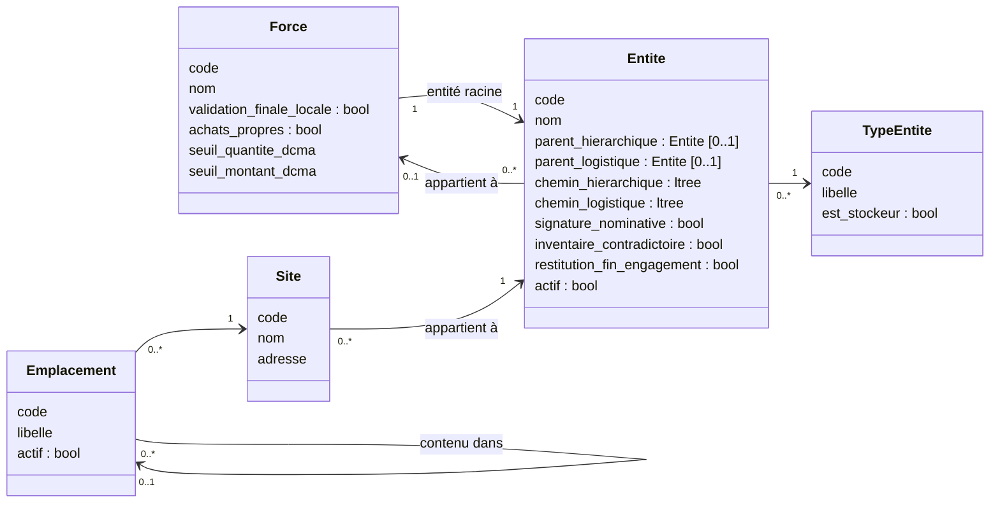
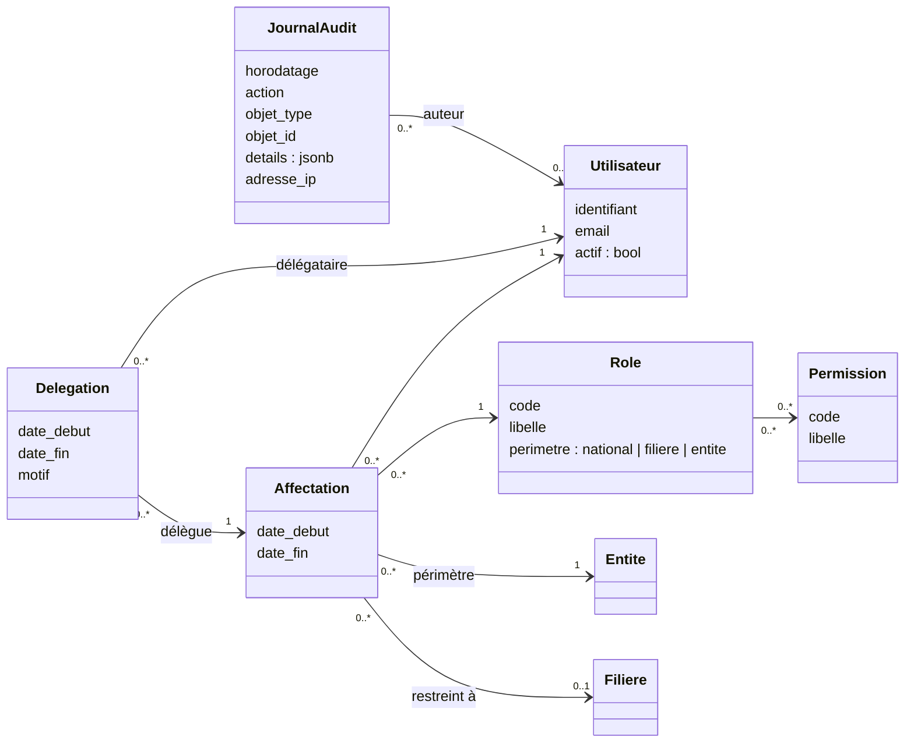
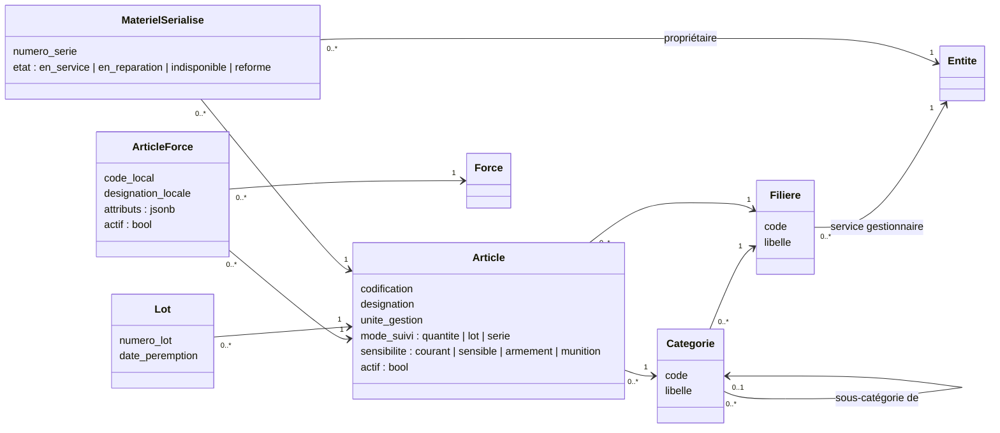
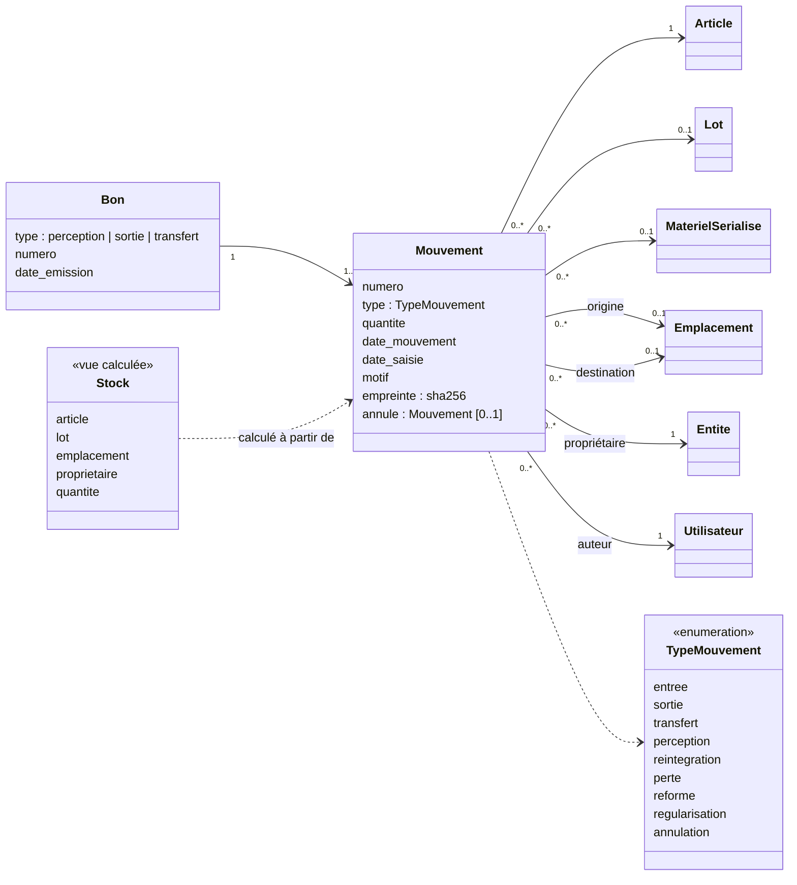
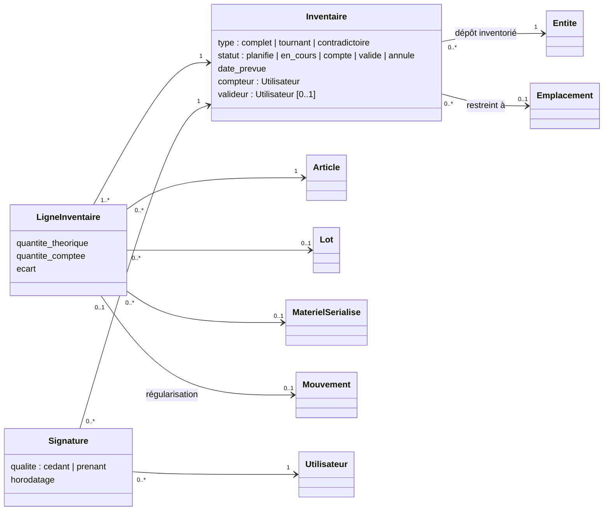

# Lot 1 « socle » : modèle de données

Ce document propose le modèle de données du lot 1 du cahier des charges (organisation, utilisateurs et droits, référentiel du matériel, stocks et mouvements, inventaires). Il sert de base de discussion : **rien n'est codé tant qu'il n'est pas validé**.

Chaque choix renvoie à une exigence (REF, STK, INV, ADM, section 4) ou à une règle de gestion (RG) du cahier des charges. Les choix qui reposent sur une **hypothèse** (règle encore « À valider » ou point ouvert de la section 9) sont repérés par un identifiant **H-xx** et récapitulés en fin de document, avec la question à trancher.

Les diagrammes sont écrits en Mermaid (syntaxe UML de diagramme de classes) : GitHub les affiche directement.

## 1. Choix structurants

Le cahier des charges (section 6.2) impose trois choix ; voici comment le modèle les traduit.

1. **Journal de mouvements immuable.** La table `mouvement` n'accepte que des insertions : la base refuse toute modification ou suppression (droits PostgreSQL et déclencheur), y compris pour l'application. Une erreur se corrige par un mouvement d'annulation qui référence le mouvement d'origine (RG-12, STK-03). Le stock n'est jamais saisi : il est calculé à partir des mouvements (RG-10).
2. **Arbres hiérarchique et logistique séparés.** Chaque entité a au plus un parent hiérarchique et au plus un parent logistique (RG-01). Chacun des deux arbres est matérialisé par un chemin `ltree` (extension PostgreSQL), ce qui permet de sélectionner une entité et toutes ses subordonnées en une seule condition, indexée.
3. **Filière.** Chaque article appartient à une filière, et chaque filière est gérée par un service central de la DCMA (RG-05, REF-03). La filière servira au lot 2 pour router les demandes ; au lot 1, elle limite déjà le périmètre des gestionnaires de filière.

## 2. Organisation (REF-06, RG-01 à RG-03, sections 2.4 et 2.5)

- **Entité** : tout nœud de l'organisation, avec un parent dans chacun des deux arbres (`parent_hierarchique`, `parent_logistique`) (DCMA, service central, force, direction du matériel, unité, dépôt, magasin…). Le type est une table et non une liste figée, pour qu'ajouter un niveau hiérarchique reste un paramétrage (section 5, « Évolutivité »).
- **Force** porte les paramètres d'autonomie de la section 2.5 (validation finale locale, achats propres, seuils au-delà desquels la DCMA intervient). La DCMA et ses services n'ont pas de force (RG-02).
- **Régime de responsabilité** (section 2.4) : trois attributs de l'entité, paramétrables, et non une exception codée en dur.
- **Site et emplacement** : un site est un lieu physique appartenant à une entité ; un emplacement est un lieu de stockage dans un site (magasin, rayonnage, cuve…), éventuellement imbriqué dans un autre. → **H-01**
- Un dépôt ou un magasin appartient à une seule entité (RG-03), donc à une seule force.

## 3. Utilisateurs, rôles et droits (section 4, ADM-01, ADM-03, RG-04)

- **Utilisateur** : le compte géré par CodeIgniter Shield (connexion, mot de passe, double facteur).
- **Rôle et permissions (RBAC)** : les dix profils de la section 4.1 deviennent des rôles stockés en base, avec leurs permissions (consulter, saisir, valider, administrer…), modifiables sans développement (ADM-02).
- **Affectation (ABAC)** : un rôle exercé sur une entité, pour une période datée (RG-04). Un utilisateur peut en avoir plusieurs. Le périmètre inclut automatiquement les entités subordonnées (règle 4.2-3), obtenues par le chemin `ltree`. Une affectation peut être restreinte à une filière (gestionnaire de filière). → **H-02**
- **Délégation** : transfert temporaire d'une affectation à un autre utilisateur, daté et tracé (règle 4.2-5).
- **Cloisonnement en base** (règle 4.2-6) : les tables métier sont protégées par la sécurité au niveau des lignes de PostgreSQL (*Row Level Security*). À chaque requête, l'application transmet l'utilisateur connecté à la base, et les politiques de sécurité ne laissent passer que les lignes de son périmètre. Un oubli dans le code PHP ne suffit donc pas à exposer des données.
- **Journal d'audit** (ADM-03, section 5 « Traçabilité ») : en insertion seule, comme le journal des mouvements.
- **Mise en œuvre** (module Utilisateurs et droits) : la portée d'un rôle est *nationale* ou *entité* ; une affectation ou une délégation peut être **révoquée** avant terme (date et auteur conservés). Le périmètre suit l'arbre **hiérarchique**. → **H-08**. Une affectation peut être limitée à une filière (H-02) depuis le module Référentiel.
- **Sécurité** (migration `CreerSecurite`) :
  - *Double facteur* (section 4.3) : attribut `double_facteur` sur `Role` ; la fonction `securite_double_facteur_requis(utilisateur)` dit si l'utilisateur détient, par affectation ou délégation active, un rôle sensible. Le code est envoyé par courriel. → **H-09**
  - *Contrôle par la sensibilité de l'article* (règle 4.2-2) : une politique restrictive sur `Mouvement` exige la permission `stocks.sensibles` pour tout article dont la sensibilité n'est pas « courant », sauf pour les régularisations d'inventaire. → **H-10**
  - *Journal des consultations* (section 5) : la consultation d'un matériel sérialisé, d'un mouvement ou d'un bon portant sur du matériel sensible ajoute une ligne `CONSULTATION` au journal d'audit.
- **Séparation des tâches** (règle 4.2-4, RG-32) : vérifiée par l'application et doublée d'une contrainte en base là où c'est possible (par exemple : le valideur d'un inventaire est différent du compteur).

## 4. Référentiel du matériel (REF-01 à REF-05, RG-05 à RG-09)

- **Article générique national** et **fiche propre à une force** (REF-02) : au plus une fiche par couple article-force (RG-09).
- **Mode de suivi** (REF-04, RG-06, RG-07) : un seul par article. Les engins roulants (motos comprises), armes et matériels optiques sont suivis par numéro de série, les munitions par lot, les carburants en quantité exprimée dans une unité de volume. → **H-03**, **H-04**
- **Sensibilité** (REF-05) : détermine les règles de traçabilité renforcées (signature nominative, inventaires plus fréquents), précisées au lot 3 pour le SAMO.
- **Matériel sérialisé** : chaque exemplaire (une arme, un engin) avec son numéro de série et son état (STK-05). Sa position et son détenteur ne sont pas saisis : ils découlent de son dernier mouvement (RG-14).
- **Mise en œuvre** (module Référentiel) : unités de gestion en table (unité, litre, mètre cube, kilogramme, tonne) ; RG-07 appliquée par trois contraintes (armement → série, munition → lot, série → unité) et par un mode de suivi que chaque catégorie peut imposer ; écriture contrôlée par la base selon la filière (`referentiel.gerer`) ou la force (`referentiel.fiche_force`). Les **lots** et les **matériels sérialisés** seront créés par les mouvements d'entrée (module Stocks et mouvements).
- **Désactivation** (REF-01) : un article n'est jamais supprimé, il est désactivé, car des mouvements y font référence.

## 5. Stocks et mouvements (STK-01 à STK-06, RG-10 à RG-14)

- **Un mouvement** porte sur un seul article (et un seul lot ou numéro de série le cas échéant), une quantité positive, un emplacement d'origine et/ou de destination, un auteur et une date (RG-11). Une entrée n'a que la destination, une sortie que l'origine, un transfert les deux.
- **Immuabilité** (RG-12, STK-03) : aucune modification ni suppression. Une annulation est un nouveau mouvement de sens inverse, lié au mouvement d'origine, qui ne peut être annulé qu'une fois.
- **Infalsifiabilité** (objectif 1.2-3) : chaque mouvement stocke une empreinte SHA-256 calculée sur son contenu et sur l'empreinte du mouvement précédent. Toute altération directe en base, même par un administrateur, rompt la chaîne et devient détectable par une vérification périodique. → **H-05**
- **Stock calculé** (RG-10, STK-01) : vue qui additionne les entrées et soustrait les sorties, par article, lot, emplacement et propriétaire. L'agrégation par entité, force ou au niveau national s'obtient en remontant les arbres.
- **Stock jamais négatif** (RG-13, validée) : contrôlé dans la même transaction que l'insertion du mouvement, avec un verrou sur la ligne de stock concernée, pour que deux sorties simultanées ne puissent pas passer toutes les deux.
- **Propriétaire et détenteur** (STK-04) : le propriétaire est porté par le mouvement ; le détenteur est l'entité à laquelle appartient l'emplacement où se trouve le matériel. → **H-06**
- **Mise en œuvre** (module Stocks et mouvements) : le stock est une table tenue exclusivement par des déclencheurs à chaque mouvement (l'application ne peut que la lire), ce qui permet de verrouiller la ligne concernée et de garantir RG-13 en concurrence ; un index unique garantit RG-14. Le calcul de l'empreinte chaînée sérialise les saisies de mouvements (verrou court) : à réévaluer quand la volumétrie sera connue. Saisir un mouvement exige `stocks.mouvementer` sur l'entité **responsable** : le destinataire pour une entrée ou une réintégration, l'expéditeur pour les autres types, celui de l'original pour une annulation. La régularisation est réservée aux inventaires.
- **Bons** (STK-06) : bon de perception, bon de sortie, bordereau de transfert, générés en PDF à partir d'un ou plusieurs mouvements, avec une numérotation continue.
- **Mise en œuvre des bons** : tables `bon` (numéro attribué par la base à partir d'un compteur verrouillé, par type et par année) et `bon_mouvement`, toutes deux en insertion seule. La table `mouvement` n'est pas modifiée, pour que les empreintes déjà calculées restent vérifiables. Bon de sortie pour sortie, perte et réforme ; bordereau de transfert pour transfert et réintégration ; pas de bon pour une entrée.

## 6. Inventaires (INV-01 à INV-03, RG-31, RG-32)

- **Déroulé** : planification, comptage, calcul des écarts, validation, puis génération d'un mouvement de régularisation pour chaque écart validé (RG-31).
- **Séparation des tâches** (RG-32) : le valideur ne peut pas être le compteur ; contrainte vérifiée en base.
- **Quantité théorique figée** : elle est copiée au lancement du comptage, pour que les mouvements ultérieurs ne faussent pas l'écart.
- **Inventaire contradictoire** (INV-03) : lors d'une passation de responsabilité, le cédant et le prenant signent. → **H-07**

**Mise en œuvre** (migration `CreerInventaires`) :

- Chaque étape est une fonction de la base (`inventaire_lancer`, `inventaire_compter`, `inventaire_ajouter_ligne`, `inventaire_terminer_comptage`, `inventaire_signer`, `inventaire_valider`, `inventaire_annuler`) qui vérifie le statut, les droits (`inventaires.gerer`, `inventaires.valider`) et la personne désignée. L'application ne peut ni modifier une ligne, ni changer un statut directement.
- **Champ** : toute l'entité inventoriée, ou un emplacement et ses sous-emplacements. Un seul inventaire en cours par entité.
- **Gel** : tant qu'un inventaire est en cours ou compté, tout mouvement autre qu'une régularisation est refusé sur les emplacements de son champ, faute de quoi la quantité théorique figée deviendrait fausse.
- **Comptage** : réservé au compteur désigné ; un matériel sérialisé se compte 1 (présent) ou 0 (absent). Un matériel trouvé mais absent du stock théorique s'ajoute comme ligne de quantité théorique nulle.
- **Validation** (RG-31, RG-32) : réservée à un détenteur de `inventaires.valider` qui n'est pas le compteur (contrôle dans la fonction et contrainte sur la table). Pour un inventaire contradictoire, les deux signatures sont exigées. Chaque écart non nul devient un mouvement de type `regularisation`, dont l'auteur est le valideur ; il entre dans le journal chaîné et le stock comme tout autre mouvement. La ligne garde le lien vers son mouvement.
- Un inventaire validé ou annulé ne change plus ; tout est tracé dans le journal d'audit.

## 7. Hypothèses à valider

Ces choix ont été faits pour pouvoir avancer ; chacun peut être modifié avant le développement du module concerné.

| Réf. | Hypothèse retenue | Question à trancher | Lien |
| --- | --- | --- | --- |
| H-01 | Un dépôt ou un magasin est une **entité** ; ses lieux physiques sont des **sites**, et ses lieux de stockage des **emplacements** | Cette distinction entité / site / emplacement correspond-elle à la réalité du terrain ? | REF-06, RG-03 |
| H-02 | Une affectation peut être restreinte à une seule filière | Un gestionnaire peut-il couvrir plusieurs filières ? | Section 4.1 |
| H-03 | L'optique est suivie par numéro de série, comme l'armement | Quels matériels optiques exactement ? | RG-07, point ouvert 9 |
| H-04 | Les carburants sont suivis en quantité dans une unité de volume (litre) ; la conversion à 15 °C (ESS-02) viendra au lot 3 | Faut-il plusieurs unités de volume (litre, m³) pour un même article ? | ESS-01, RG-08 |
| H-05 | Chaînage des mouvements par empreinte SHA-256 pour rendre toute altération détectable | Ce niveau de preuve suffit-il, ou faut-il un horodatage ou une signature par un tiers ? | Objectif 1.2-3 |
| H-06 | Le détenteur est l'entité qui possède l'emplacement où se trouve le matériel | Un matériel peut-il être détenu par une entité sans être stocké chez elle (prêt, mission) ? | STK-04 |
| H-07 | Signature électronique simple : validation par l'utilisateur authentifié, horodatée et journalisée | Faut-il une signature manuscrite numérisée ou un certificat ? | INV-03, ARM-03 |
| H-08 | Le périmètre d'une affectation de portée « entité » couvre l'entité et ses subordonnées dans l'arbre **hiérarchique** | Un service logistique doit-il aussi voir les entités qu'il ravitaille (arbre logistique) ? Ce besoin apparaîtra surtout avec les demandes (lot 2) | Règle 4.2-3 |
| H-09 | Second facteur par code envoyé par courriel ; rôles sensibles par défaut : administrateurs, directeur DCMA, auditeur, armurier | Le courriel suffit-il, ou faut-il une application d'authentification (TOTP), une carte ou l'annuaire de la défense ? Quels rôles sont sensibles ? | Section 4.3 |
| H-10 | Un droit supplémentaire unique (`stocks.sensibles`) pour l'armement, les munitions et le matériel sensible ; la consultation reste ouverte à tout le périmètre mais est journalisée | Faut-il des droits distincts par sensibilité, ou restreindre aussi la consultation ? | Règle 4.2-2, section 5 |

## 8. Règles de gestion et points ouverts qui conditionnent le lot 1

Le modèle ci-dessus applique les règles suivantes telles que rédigées dans le cahier des charges. Leur statut est encore « À valider », sauf mention contraire :

- **Organisation** : RG-01, RG-02, RG-03 (sans statut), RG-04.
- **Référentiel** : RG-05, RG-06, RG-07 et RG-08 (sans statut), RG-09.
- **Stocks** : RG-10, RG-11, RG-12, RG-13 (validée), RG-14.
- **Inventaires** : RG-31, RG-32.

Points ouverts de la section 9 qui touchent le lot 1 :

- Direction du matériel et service logistique d'une force : une seule entité ou deux ? Le modèle accepte les deux cas, mais le paramétrage initial en dépend.
- Existe-t-il des échelons intermédiaires (directions régionales) ? Le modèle les accepte sans modification, grâce aux arbres.
- Les services centraux détiennent-ils leurs propres dépôts ? Le modèle l'autorise.
- Régime de responsabilité des entités à personnel non permanent : quelles valeurs par défaut ?

## 9. Prochaine étape

Une fois ce modèle validé (ou corrigé), le développement suivra l'ordre des dépendances, un module par pull request avec ses tests :

1. Organisation : types d'entités, forces, entités et leurs deux arbres, sites, emplacements.
2. Utilisateurs, rôles, affectations et délégations, avec le cloisonnement en base et les tests de cloisonnement (critère de recette 7.3-2).
3. Référentiel du matériel.
4. Stocks et mouvements, puis les bons PDF.
5. Inventaires.

Toutes les données utilisées en développement et dans les tests sont **fictives**.
