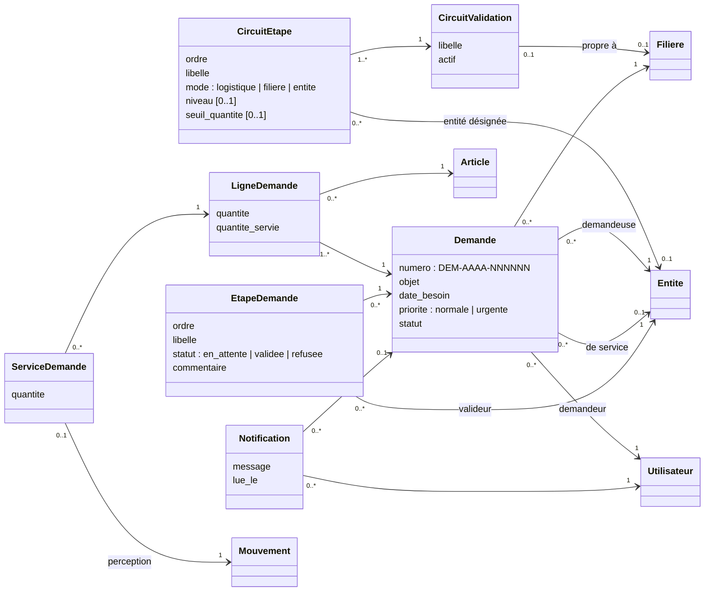

# Lot 2 : demandes et validations

Ce document décrit le module Demandes (DEM-01 à DEM-04, règles RG-15 à RG-19, ADM-02 pour les circuits). Il complète le modèle du lot 1 (`lot1-modele-de-donnees.md`), dont il réutilise l'organisation (arbre logistique, filières), les droits et les mouvements de stock.

## 1. Modèle

## 2. Règles appliquées par la base

- **Une filière par demande** (RG-16), **un article par ligne** et une ligne par article (RG-15). Les lignes ne se modifient qu'en brouillon.
- **Routage** (DEM-02) : à la soumission, le circuit de la filière (à défaut, le circuit par défaut) est copié en étapes concrètes. Chaque étape est confiée à une entité :
  - un échelon de la **chaîne logistique** du demandeur (niveau 1 = parent logistique) ;
  - le **service gestionnaire de la filière** ;
  - ou une **entité désignée**.

  Une étape avec un **seuil** ne s'applique que si une ligne atteint cette quantité (DEM-03). L'**entité de service** est le parent logistique du demandeur, à défaut le service gestionnaire de la filière. → **H-11, H-12**
- **Validation** : à l'étape en cours, un détenteur de `demandes.valider` dont l'affectation couvre l'entité de l'étape, dans la limite de sa filière. Le **demandeur ne valide jamais sa propre demande** (RG-19, règle 4.2-4). Les délégations s'appliquent. Un refus exige un motif et termine la demande. → **H-13**
- **Service** (RG-17) : chaque service est une **perception**. Elle part d'un emplacement de l'entité de service ou de ses dépôts et arrive à un emplacement de l'entité demandeuse ; elle est saisie par l'utilisateur qui la rattache. Elle ne peut pas dépasser le reste à servir. La perception, son bon et le rattachement forment une seule transaction. L'annulation d'une perception rattachée réduit la quantité servie.
- **États** (RG-18) : brouillon → soumise → en validation → validée ou refusée → en service → servie, ou clôturée (reliquat abandonné, motif obligatoire). L'annulation est possible tant que rien n'a été servi.
- **Suivi** (DEM-04) : un historique horodaté par demande et des **notifications** dans l'application. Sont notifiés : les valideurs de l'étape suivante, le demandeur à chaque décision et à chaque service, et les gestionnaires de l'entité de service quand la demande est validée. → **H-14**
- **Cloisonnement** : une demande est visible de son demandeur, du périmètre de l'entité demandeuse, du périmètre de chacune de ses étapes et de l'entité de service, dépôts subordonnés compris. Le libellé de l'entité demandeuse et ses emplacements de livraison sont lisibles par qui doit valider ou servir, sans ouvrir le reste de l'organisation. Les statuts, les étapes, les services et les notifications ne s'écrivent que par les fonctions de la base.

## 3. Hypothèses à valider

| Réf. | Hypothèse retenue | Question à trancher | Lien |
| --- | --- | --- | --- |
| H-11 | L'entité de service est le parent logistique du demandeur, et ses dépôts subordonnés servent | Une demande peut-elle être servie directement par un dépôt d'une autre force ou par un dépôt central ? | DEM-02 |
| H-12 | Le seuil d'une étape porte sur la **quantité** d'une ligne ; le seuil de **montant** viendra avec les prix (module Approvisionnement) | Faut-il plutôt un seuil sur la quantité totale, sur le montant, ou par sensibilité de l'article ? | DEM-03 |
| H-13 | Un valideur accepte ou refuse la demande entière ; il ne modifie pas les quantités | Un valideur doit-il pouvoir réduire une quantité (validation partielle) ? | DEM-03, RG-17 |
| H-14 | Notifications dans l'application seulement | Faut-il aussi un courriel, et pour quels événements ? | DEM-04 |

La consolidation des besoins (DEM-05, priorité P2) n'est pas traitée dans ce module.
